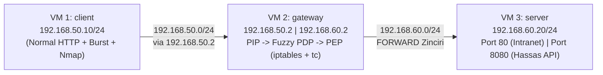
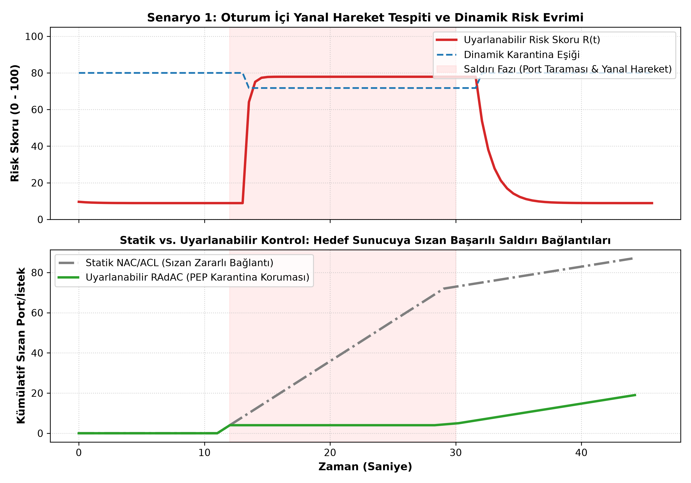
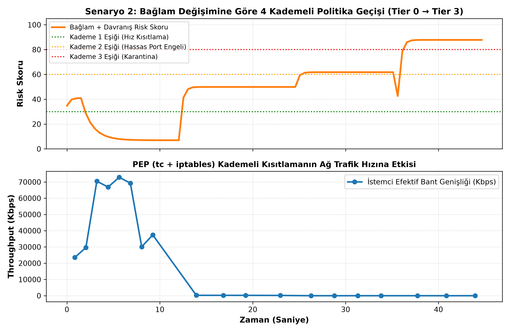
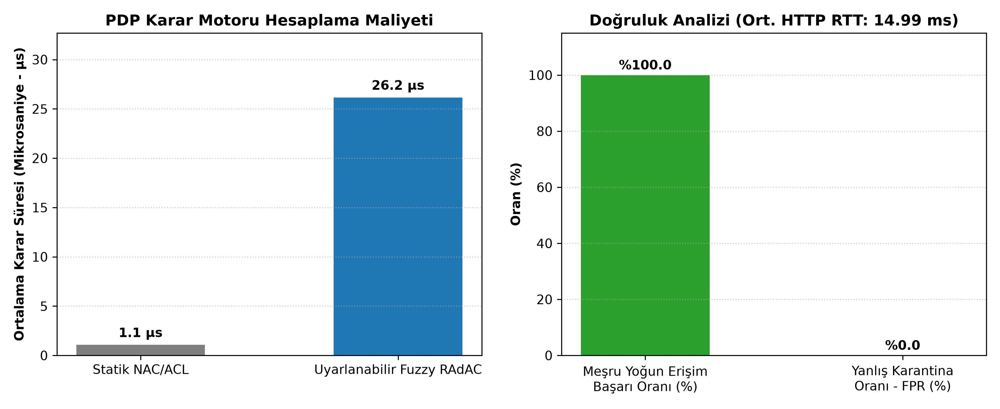

# Fuzzy-RAdAC: Uyarlanabilir (Adaptive) Ağ Erişim Kontrolü Laboratuvarı

> **Context & Behavior-Aware Adaptive Network Access Control** — Linux çekirdeği (`iptables`, `tc`, `nf_conntrack`) üzerinde yamuk bulanık mantık (*Trapezoidal Fuzzy Logic*), asimetrik risk hafızası (*EWMA*) ve dinamik eşik hesaplaması kullanan 3 sanal makineli **Zero Trust / RAdAC** deney ortamı.

[](#)
[](#)
[](#)

---

## 1. Proje Amacı ve Problem Tanımı

Klasik statik ağ erişim kontrolü yaklaşımları (802.1X NAC, statik ACL, RBAC), erişim kararını yalnızca bağlantı kurulurken bir kez verir. Oturum açıldıktan sonra istemci cihaz ele geçirilse, güvenlik duruşu bozulsa veya içeride port taraması (*lateral movement / reconnaissance*) başlatsa bile sahip olduğu yetki sabit kalır.

Bu projede oturum boyunca ağ davranışını ve cihaz/kaynak bağlamını sürekli izleyen, ikili (*İzin Ver / Engelle*) karar yerine **4 kademeli** tepki uygulayan uyarlanabilir bir **PIP → PDP → PEP** mimarisi geliştirilmiş ve izole bir 3 sanal makineli laboratuvarda deneysel olarak ölçülmüştür.

---

## 2. Sistem Mimarisi ve Sanal Ağ Topolojisi

Test ortamı VMware Workstation üzerinde Vagrant ile ayağa kaldırılan üç adet izole Ubuntu 22.04 sanal makinesinden oluşur. İstemci ve sunucu farklı alt ağlardadır; tüm trafik zorunlu olarak ortadaki Linux yönlendirici (`gateway`) üzerinden geçer.



| Sanal Makine | IP Adresi | Rol | Temel Bileşenler |
| :--- | :--- | :--- | :--- |
| **`client`** | `192.168.50.10/24` | İstemci & Saldırı Üreticisi | `experiments/client_traffic_runner.py`, `nmap`, `hping3`, `curl` |
| **`gateway`** | `192.168.50.2` / `192.168.60.2` | Yönlendirici & Karar/Yürütme Noktası | `pip_collector.py`, `pdp_engine.py`, `pep_enforcer.py`, `controller_daemon.py` |
| **`server`** | `192.168.60.20/24` | Hedef Kurumsal Sunucu | `server_app/target_server.py` (Port 80 & Port 8080, JSONL erişim logları) |

---

## 3. PIP – PDP – PEP Çalışma Mantığı

### 3.1. PIP — Politika Bilgi Noktası ([`pip_collector.py`](gateway_engine/pip_collector.py))
- Linux çekirdeğindeki `/proc/net/nf_conntrack` (veya `conntrack -L`) tablosundan aktif akışları okuyarak taranan benzersiz port sayısını (`unique_ports`), yarı-açık/yanıtsız bağlantı sayısını (`syn_unanswered`) ve hassas portların (`8080`, `22`, `9000`) hedeflenip hedeflenmediğini (`sensitive_targeted`) çıkarır.
- `iptables -L FORWARD -v -n -x` sayaçlarından paket akış hızını hesaplar ve `context_state.json` içindeki cihaz güvenlik duruşu (`device_posture_risk`), mesai dışı bilgisi (`off_hours`) ve kaynak hassasiyeti (`resource_sensitivity`) ile birleştirir.

### 3.2. PDP — Bulanık Mantık Karar Motoru ([`pdp_engine.py`](gateway_engine/pdp_engine.py))
1. **Yamuk Bulanık Üyelik (`trapmf`):** Bağlantı hızı (`conn_rate`) ve port tarama metriği (`unique_ports + syn_unanswered * 0.5`) için keskin `if-else` sınırları yerine yumuşak geçişli yamuk üyelik fonksiyonlarıyla bulanık risk puanları hesaplanır.
2. **Asimetrik Risk Hafızası (EWMA):** Güven yavaş kazanılıp hızlı kaybedildiği için risk yükselirken `%80` anlık ağırlıkla hızla tepki verilir (`0.80 * instant_risk + 0.20 * history_score`); tehdit kesildiğinde ise `%35` ağırlıkla kademeli soğuma sağlanır.
3. **Dinamik Eşik Ayarlama:** Hedeflenen kaynağın hassasiyetine bağlı olarak (`res_sens > 30`) kademe eşikleri aşağı çekilir (`th_tier3` baz değeri `80`'den hassas port erişiminde otomatik düşürülür).
4. **Kıyaslama Modları:** `--mode static` klasik oturum boyu sabit izin (`TIER_0_ALLOW`) davranışını, `--mode adaptive` ise önerilen Fuzzy RAdAC motorunu çalıştırır.

### 3.3. PEP — Linux Ağ Katmanı Yürütmesi ([`pep_enforcer.py`](gateway_engine/pep_enforcer.py))
Özel `PEP_ENFORCE` `iptables` zinciri (`FORWARD` sırası `1`) ve çift yönlü `tc` (*Traffic Control — Token Bucket Filter*) ile dört kademeli müdahale uygular (kademe değişmediğinde yeniden kural basmayarak işlem yükünü sıfırlar):

| Risk Aralığı | Kademe | PEP Aksiyonu (`iptables` / `tc`) |
| :--- | :--- | :--- |
| `0 – 30` | **`TIER_0_ALLOW`** | Tam erişim (`ACCEPT`) |
| `31 – 60` | **`TIER_1_RATELIMIT`** | Çift yönlü `tc tbf 256kbit` bant genişliği sınırı + `15/sec` paket limiti |
| `61 – 80` | **`TIER_2_RESTRICT`** | Hassas portlar (`8080, 22, 9000`) `REJECT`; Port `80` için `128kbit` + `5/sec` kısıtlama |
| `> Dinamik Eşik` | **`TIER_3_QUARANTINE`** | Tam karantina (`iptables DROP`) |

---

## 4. Dizin Yapısı

```text
.
├── Vagrantfile                         # 3 Ubuntu 22.04 VM ve iki izole alt ağı (50.x / 60.x) tanımlar
├── run_all_experiments.ps1             # Senaryo 1, 2 ve 3'ü otomatik koşturan PowerShell orkestrasyonu
├── setup/
│   ├── gateway_setup.sh                # ip_forward=1, iptables, iproute2, conntrack, iperf3 kurulumu
│   ├── server_setup.sh                 # Dönüş rotası + systemd target-services.service kurulumu
│   └── client_setup.sh                 # nmap, hping3, curl kurulumu ve Gateway üzerinden statik rota
├── gateway_engine/
│   ├── pip_collector.py                # conntrack + iptables sayaç + context_state okuyucu (PIP)
│   ├── pdp_engine.py                   # Statik ve Bulanık Mantık + EWMA + Dinamik Eşik motoru (PDP)
│   ├── pep_enforcer.py                 # iptables + çift yönlü tc TBF uygulayıcı (PEP)
│   ├── controller_daemon.py            # Her 0.5 sn'de PIP->PDP->PEP döngüsü ve CSV kayıt betiği
│   ├── live_demo_gateway.py            # Canlı sunum için her 0.8 sn'de ekrana risk tablosu basan modül
│   └── context_state.json              # Cihaz duruşu / mesai saati / kaynak hassasiyeti bağlam dosyası
├── server_app/
│   └── target_server.py                # Port 80 (Intranet) ve Port 8080 (Hassas API) çoklu thread HTTP sunucusu
├── experiments/
│   ├── client_traffic_runner.py        # Senaryo 1, 2 ve 3 için trafik, burst ve TCP port tarama üreticisi
│   └── plot_results.py                 # CSV/JSON çıktılarından 300 DPI grafikler ve özet JSON üreten betik
├── pycharm_demo/
│   ├── 1_sunucu_baslat.py              # Adım 1: Hedef sunucu servisini ve canlı erişim loglarını başlatır
│   ├── 2_gateway_baslat.py             # Adım 2: Gateway üzerindeki canlı karar motorunu çalıştırır
│   └── 3_istemci_canli_demo.py         # Adım 3: Normal -> Hız Kısıtlama -> Nmap -> Karantina canlı demosu
└── results/                            # Gerçek deneylerden elde edilen CSV, JSON ve grafik (.png) çıktıları
```

---

## 5. Kurulum ve Çalıştırma

### Ön Koşullar
- **Vagrant** (2.4+) ve **VMware Workstation** (`vagrant-vmware-desktop` eklentisi) veya VirtualBox
- Host makinede grafik üretimi için **Python 3.10+**, `matplotlib`, `numpy`

### Adım 1: Sanal Makineleri Ayağa Kaldırma
```powershell
vagrant up --provider=vmware_desktop
```

### Adım 2: Tüm Deney Senaryolarını Çalıştırma ve Grafikleri Üretme
```powershell
.\run_all_experiments.ps1
```
Bu komut sırasıyla Senaryo 1A (Statik), Senaryo 1B (Adaptive), Senaryo 2 (4 Kademeli Hız Kısıtlama) ve Senaryo 3'ü (Performans & False Positive) koşturup çıktıları `results/` altına yazar ve `experiments/plot_results.py` ile grafikleri çizer.

### Adım 3: Canlı Demo Akışı (PyCharm / Terminal)
Üç ayrı terminal/PyCharm Run penceresinde sırayla çalıştırılır:
1. `python pycharm_demo/1_sunucu_baslat.py` — Port 80 & 8080 servislerini başlatır ve gelen istekleri canlı loglar.
2. `python pycharm_demo/2_gateway_baslat.py` — Gateway üzerinde her `0.8` sn'de bağlantı hızı, port sayısı, Risk Skoru, Dinamik Eşik ve PEP kademesini yazdırır.
3. `python pycharm_demo/3_istemci_canli_demo.py` — Otomatik olarak 4 adımı yürütür: Normal HTTP (`OK`) → Bağlam değişimi (Kademe 1 Hız Kısıtlama) → `nmap` yanal hareket taraması (Kademe 3 Karantina) → Karantina sonrası erişim engeli doğrulaması.

---

## 6. Deneysel Sonuçlar

Gerçekleştirilen ölçümler [`results/experiment_summary.json`](results/experiment_summary.json) dosyasında özetlenmiştir:

### Senaryo 1: Oturum İçi Yanal Hareket ve Port Taraması
- **Statik NAC/ACL Sızan Bağlantı/Port:** `87`
- **Uyarlanabilir Fuzzy RAdAC Sızan Bağlantı/Port:** `19` (~**%78** azalma)
- **Karantina Tetiklenme Süresi:** Saldırı başladıktan kısa süre sonra (`14.04.` saniyede) karantina devreye girerek yeni sızıntıları tamamen durdurmuştur.



### Senaryo 2: Bağlama Göre 4 Kademeli Bant Genişliği Kontrolü
- **Kademe 0 (`Tam Erişim`):** ortalama **`50.006,6 Kbps`** (~50 Mbps)
- **Kademe 1 (`tc 256kbit Hız Kısıtlama`):** ortalama **`216,3 Kbps`**
- **Kademe 2 (`Hassas Servis Engeli`):** **`0,0 Kbps`** (bulk indirme ve Port 8080 kesilir)
- **Kademe 3 (`Tam Karantina`):** **`0,0 Kbps`** (`iptables DROP`)



### Senaryo 3: Hesaplama Maliyeti ve Yanlış Karantina (FPR) Analizi
- **Statik PDP Ortalama Karar Süresi:** `1,08 µs`
- **Uyarlanabilir Fuzzy PDP Ortalama Karar Süresi:** `26,16 µs`
- **PEP Kural Uygulama Süresi (`iptables` / `tc`):** ortalama `47,99 ms` (yalnızca kademe geçişlerinde)
- **Ortalama HTTP RTT:** `14,99 ms`
- **Meşru Yoğun Trafik (*Legitimate Burst*) Başarısı:** `15/15` istek onaylandı (**%0,0 Yanlış Karantina Oranı / FPR**)



---

## 7. Akademik Referanslar

- **[1] NIST SP 800-162:** *Guide to Attribute Based Access Control (ABAC) Definition and Considerations* — PIP/PDP/PEP mimarisi.
- **[2] NIST SP 800-207:** *Zero Trust Architecture* — Sürekli doğrulama ve dinamik politika yürütme prensipleri.
- **[5] Atlam vd. (2018):** *Fuzzy Logic in Risk-Based Access Control* (IJCNIS) — Bağlamsal özniteliklerden bulanık mantıkla risk puanlaması.
- **[9] Bradatsch vd. (2024):** *Score-Based Network-Level Access Control* (IEEE TrustCom) — Dinamik eşik yaklaşımı ve PDP gecikme değerlendirmesi.
- **[10] Lee vd. (2017):** *Situational Awareness Based RAdAC* (IoTBDS) — Durumsal farkındalık tabanlı dinamik güvenlik duvarı yürütmesi.

---

**Geliştirici:** Hüseyin Arda Hoşcan
